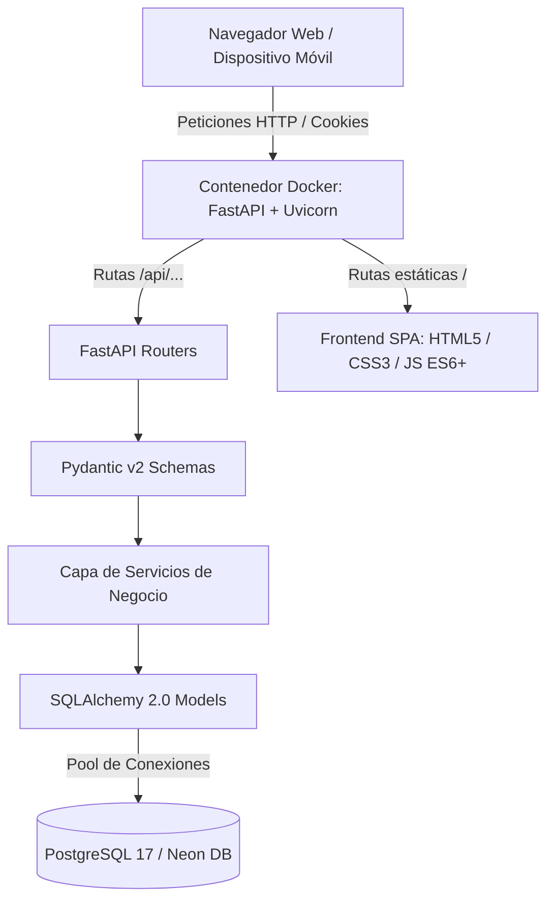

# Documento de Arquitectura de Software (SAD)
**Sistema de Inventario de Activos y Hojas de Vida Tecnológicas**

* **Organización:** Fundación Fondacio Colombia (Sedes YLDC Potosí, Altos del Cabo y Administrativa)
* **Tipo de Documento:** Documento de Arquitectura de Software (SAD - Software Architecture Document)
* **Tecnologías Principales:** FastAPI, PostgreSQL 17, SQLAlchemy 2.0, Alembic, Docker, Vanilla JS ES6+
* **Fecha de Emisión:** Octubre de 2026 | **Versión:** 2.0 (Producción)

---

## 1. Visión General y Patrón Arquitectónico

El Sistema de Inventario de Hardware de Fondacio Colombia adopta un patrón arquitectónico **Cliente-Servidor Desacoplado con Despliegue Unificado en Contenedor**. Esta solución combina lo mejor de dos mundos:
1. **Frontend:** Una Single Page Application (SPA) en Vanilla JavaScript moderna, ligera, sin dependencias de compilación complejas ni sobrecarga de frameworks.
2. **Backend:** Una API RESTful asíncrona de alto rendimiento construida con FastAPI (Python 3.13 / 3.14) montada sobre el servidor ASGI Uvicorn.
3. **Persistencia:** Base de datos relacional PostgreSQL con SQLAlchemy 2.0 (ORM) y migraciones declarativas con Alembic.
4. **Despliegue:** Imagen de contenedor Docker única que compila dependencias con `uv` y sirve tanto la API en `/api` como el frontend estático en `/`.

---

## 2. Descripción Detallada de las Capas del Sistema

### 2.1. Capa de Presentación (Frontend SPA)
* **Arquitectura Vanilla JS Modular:** Desarrollado en JavaScript moderno (ES6+) sin frameworks pesados (React, Angular o Vue), garantizando tiempos de carga ultrarrápidos y compatibilidad duradera.
* **Enrutamiento SPA en Cliente:** La navegación entre vistas (Dashboard, Inventario, Sedes, Préstamos, Mantenimiento, Diagnóstico y Ajustes) se realiza dinámicamente mediante manipulación selectiva del DOM sin recargas de página completa.
* **Capa de Abstracción de Datos (`DataStoreAPI` en `frontend/js/data.js`):** Centraliza todas las interacciones HTTP con la API (`/api/...`) inyectando credenciales de cookie, serializando cuerpos JSON y controlando errores 401 de forma unificada.
* **Diseño y Estilos Adaptativos (`frontend/css/styles.css`):** Sistema basado en tokens y variables CSS que soporta modo claro, modo oscuro, paletas institucionales dinámicas y diseño totalmente responsivo para móviles y escritorios.

### 2.2. Capa de Enrutamiento y Exposición (FastAPI Routers)
* **Enrutador de Autenticación (`app.routers.auth`):** Gestión de inicio de sesión (`POST /api/auth/login`), verificación (`GET /api/auth/me`), cambio de contraseña (`POST /api/auth/contrasena`) y cierre (`POST /api/auth/logout`).
* **Enrutador de Usuarios (`app.routers.usuarios`):** Administración de cuentas (`/api/usuarios`) con regla de autorización estricta exclusiva para el usuario `admin`.
* **Enrutador de Equipos (`app.routers.equipos`):** Búsqueda paginada, gestión de hardware, subida/borrado de imágenes binarias y exportación nativa a Excel (`/api/equipos/export.xlsx`).
* **Enrutadores de Dominio:** Sedes (`/api/sedes`), Préstamos (`/api/prestamos`), Mantenimientos (`/api/mantenimientos`), Dashboard (`/api/dashboard`) y Configuración (`/api/configuracion`).

### 2.3. Capa de Negocio y Validación (Pydantic Schemas & Services)
* **Validación Declarativa (`app.schemas.*`):** Uso de Pydantic v2 para tipado estricto, alias de atributos camelCase/snake_case, validación de longitudes y conversión de tipos.
* **Lógica de Dominio (`app.services.*`):** Implementación desacoplada de reglas de negocio (cierre forzado de sesiones al desactivar usuario, verificación de nombres duplicados, cálculo de moras).
* **Auditoría Automática (`app.services.auditoria`):** Rastro inmutable de auditoría para cada mutación en la base de datos.

### 2.4. Capa de Persistencia y Modelado de Datos (SQLAlchemy & PostgreSQL)
* **ORM Declarativo (`app.models.*`):** Modelos mapeados con SQLAlchemy 2.0 (`Usuario`, `Sesion`, `Auditoria`, `Sede`, `Equipo`, `EquipoImagen`, `Prestamo`, `Mantenimiento`, `Configuracion`).
* **Estrategia de Identificadores (UUIDv4):** Identificadores de texto únicos generados con UUIDv4 para preservar llaves en migraciones y evitar colisiones concurrentes.
* **Migraciones Declarativas (Alembic):** Control de versiones del esquema relacional en `alembic/versions/` para actualizaciones sin pérdida de datos.
* **Motor de Base de Datos:** PostgreSQL 17 optimizado con índices btree en llaves foráneas, fechas y campos de búsqueda.

---

## 3. Arquitectura de Seguridad y Control de Acceso

| Mecanismo de Seguridad | Implementación Técnica |
|---|---|
| **Autenticación por Sesión Stateful** | Se almacena el hash del token en la tabla `sesiones` (expira en 8 horas). El cliente recibe una cookie HTTP-only segura sin acceso mediante scripts (defensa contra XSS). |
| **Cifrado de Contraseñas (Argon2)** | Se implementa Argon2id a través de la librería `argon2-cffi`. Este algoritmo es *memory-hard*, brindando máxima resistencia contra ataques de fuerza bruta y hardware GPU/ASIC especializado. |
| **Control de Acceso Basado en Roles (RBAC)** | Segregación entre rol `admin` (control total) y `consulta` (solo lectura). Adicionalmente, la creación de usuarios está restringida a nivel de código exclusivamente al usuario con nombre `admin`. |
| **Protección contra Fuerza Bruta** | El componente `limite_login` mantiene un conteo de fallos en memoria; tras 5 intentos fallidos consecutivos, bloquea temporalmente al usuario durante 15 minutos (429 Too Many Requests). |
| **Trazabilidad y No Repudio** | La tabla `auditoria` registra usuario, acción, entidad, identificador, timestamp UTC y el diff de cambios en JSONB para auditorías forenses. |

---

## 4. Infraestructura, Contenerización y Despliegue

* **Dockerfile Multietapa:** Construcción basada en `ghcr.io/astral-sh/uv` para compilación ultrarrápida de dependencias Python en etapa `dependencias`, y ejecución sobre imagen limpia `python:3.13-slim` bajo usuario no privilegiado `app`.
* **Orquestación Local (`compose.yaml`):** Define el servicio `db` (PostgreSQL 17 Alpine con healthcheck) y el servicio `app` (FastAPI sirviendo la API y el volumen del frontend montado en caliente para desarrollo instantáneo).
* **Despliegue en la Nube (Render):** Configuración lista para Render Web Service con terminación SSL/HTTPS automática en el proxy inverso (`FORWARDED_ALLOW_IPS='*'`) y conexión segura a Neon PostgreSQL mediante SSL.
